# Pillar 1: System & Data Architecture — YSFlight Interoperability & Asset Pipeline

**Target Architecture:** LokYS Native C++20 Flight Simulator  
**Protocol:** TOPA (Token-Optimized Aerospace Physics Architecture)  
**Document:** `docs/01_architecture.md`  
**Revision:** 1.0  

---

## 1. Executive Summary & Architectural Overview

This document specifies the system architecture for ingesting legacy YSFlight assets (aircraft, 3D articulated models, cockpit panels, scenery fields, and starting points) into the modern LokYS C++20 / Direct3D 12 simulation platform. The design guarantees zero runtime heap churn, zero third-party dependencies outside the platform toolchain, and deterministic memory layouts based on Data-Oriented Design (DOD).

```
===================================================================================================
ASSET INGESTION & PIPELINE ARCHITECTURE
===================================================================================================
[ Legacy YSFlight Assets ]         [ Modern Packaged Containers ]
  .DAT / .DNM / .SRF / .IST             .acft.zip / .objects.zip
  .FLD / .STP / .LST                    .lfs (Scenery Archive)
           │                                       │
           └───────────────────┬───────────────────┘
                               ▼
               [ Virtual File System (VFS) Layer ]
                 - In-Memory ZIP Stream Extractor
                 - Zero Disk Unpacking / Direct Buffer Read
                               ▼
               [ AssetCore Ingestion & Parsing ]
        ┌──────────────────────┼──────────────────────┐
        ▼                      ▼                      ▼
  [ Aircraft Pipeline ]  [ 3D Model Pipeline ]  [ Scenery Pipeline ]
   - .DAT -> AeroConfig   - .DNM -> Node Tree    - .FLD -> Elevation Grid
   - .IST -> Gauge Layout - .SRF -> Triangulation - .STP -> Spawn Points
   - Mass/Inertia Tensor  - Vertex/Color Buffers - Placed Object Instances
        └──────────────────────┼──────────────────────┘
                               ▼
               [ LokYS Core Engine Runtime ]
     ┌─────────────────────────┴─────────────────────────┐
     ▼                                                   ▼
[ 6-DOF Flight Dynamics (120Hz) ]         [ Direct3D 12 Rendering Pipeline ]
 - RK4 State Integration                   - Articulated Scene-Graph Solver
 - Empennage & Rotor Polars                - Procedural / Textured Mesh Passes
 - Oleo & Ground Reactions                 - PFD & Vector Gauge Compositor
===================================================================================================
```

---

## 2. Legacy Format to Modern C++ Mapping

### 2.1 Aircraft Dynamics & Configuration (`.dat` -> `AircraftConfig`)

YSFlight `.dat` files store flight physics, propulsion, limits, and visual attachment points as space-delimited key-value tokens. The `AssetCore` parser extracts these tokens and transforms them into strongly typed C++20 structures:

| YSFlight `.dat` Tag | Semantic Meaning | LokYS C++ Target Structure & Field | Conversion Formula / Transformation |
| :--- | :--- | :--- | :--- |
| `IDENTIFY` | Aircraft Identifier | `AircraftConfig::name` (`std::string`) | Direct string assignment |
| `WEIGHCLN` | Clean Empty Weight | `AircraftMassConfig::emptyMass_kg` | Converted from `kg`, `t`, or `lbs` to $\text{kg}$ |
| `WEIGFUEL` | Fuel Capacity | `AircraftMassConfig::fuelCapacity_kg` | Direct conversion to $\text{kg}$ |
| `WEIGLOAD` | Payload Capacity | `AircraftMassConfig::maxPayload_kg` | Direct conversion to $\text{kg}$ |
| `WINGAREA` | Wing Surface Area | `AircraftConfig::geometry.wingArea_m2` | Converted from $\text{m}^2$ or $\text{sqft}$ |
| `PROPELLR` / `REALPROP` | Piston Prop Engine Specs | `AircraftConfig::engine` (`EngineConfig`) | Converts HP/kW to Watts, extracts blade count, inertia, pitch bounds |
| `PROPVMIN` | Min Flight Speed | `AircraftConfig::vSpeeds.vMin_mps` | Converted from `kt` or `km/h` to $\text{m/s}$ |
| `CRITSPED` / `MAXSPEED` | Vne / Max Permissible | `AircraftConfig::vSpeeds.vNe_mps` | Converted from `kt` or `km/h` to $\text{m/s}$ |
| `CRITAOAP` / `CRITAOAM` | Stall Angle of Attack | `AeroDerivativesConfig::alphaStallPos_rad` | Converted from degrees to radians |
| `CLBYFLAP` / `CDBYFLAP` | Flap Lift & Drag Increments | `AeroDerivativesConfig::dCL_flap`, `dCD_flap` | Direct dimensionless scalar assignment |
| `CDBYGEAR` | Gear Parasite Drag | `AeroDerivativesConfig::dCD_gear` | Direct dimensionless scalar assignment |
| `LEFTGEAR` / `RIGHGEAR` | Main Landing Gear Coords | `AircraftConfig::gear.struts[1..2].attachmentFRD` | Coordinate conversion (YS -> FRD) |
| `WHELGEAR` | Nose/Tail Wheel Coords | `AircraftConfig::gear.struts[0].attachmentFRD` | Coordinate conversion (YS -> FRD) |
| `COCKPITP` | Pilot Eye Coordinate | `AircraftConfig::cockpitEyeFRD` | Coordinate conversion (YS -> FRD) |
| `INSTPANL` | Cockpit Panel Script | `AircraftConfig::instrumentPanelPath` | Relative path to `.ist` file |

### 2.2 Articulated 3D Models (`.dnm` + `.srf` -> Scene Graph & D3D12 Buffers)

- **`.srf` (Surface Geometry):** Polygons, vertices, normals, and vertex/face colors.
  - Parsed into contiguous vertex buffers `std::vector<D3D12Vertex>` ($X, Y, Z, N_x, N_y, N_z, R, G, B, A$).
  - Polygons with $N > 3$ vertices are fan-triangulated or ear-clipped deterministically.
- **`.dnm` (Dynamic Model):** Articulated hierarchy of geometry blocks with animation classes:
  - `PCK "<name>"`: Child component block boundary.
  - `CLA <id>`: Animation class identifier:
    - `CLA 0`: Static airframe component.
    - `CLA 1` / `CLA 2`: Main landing gear retraction.
    - `CLA 3` / `CLA 4`: Nose/tail gear retraction & steering.
    - `CLA 5`: Flaps deflection.
    - `CLA 6`: Elevator deflection.
    - `CLA 7`: Ailerons deflection.
    - `CLA 8`: Rudder deflection.
    - `CLA 9`: Airbrakes / Spoilers.
    - `CLA 24`: Continuous propeller rotation.
  - `STA`: State transformations (translations and rotation vectors in YSFlight units).
  - `POS`: Local pivot coordinate offset relative to parent node.

### 2.3 Cockpit Avionics & Instrumentation (`.ist` -> `AvionicsSystem`)

YSFlight `.ist` files configure 2D analogue instruments on a normalized $(-1.0 \le X \le 1.0, -1.0 \le Y \le 1.0)$ panel:
- `AIRSPEED x y r`: Airspeed Indicator position and dial radius.
- `ATTITUDE x y r`: Attitude Director Indicator (Artificial Horizon).
- `ALTITUDE x y r`: Barometric Altimeter.
- `TRNCOORD x y r`: Turn Coordinator / Slip-Skid indicator.
- `HEADING_ x y r`: Directional Gyro / Heading Card.
- `VERTICAL x y r`: Vertical Speed Indicator (VSI).
- `VOR_____` / `ILS_____`: Radionavigation indicators.
- `NUMTACHO` / `TACHOPOS`: Engine tachometer dial and RPM arcs.

The `AvionicsSystem` maps these coordinates directly to the procedural Direct3D 12 vector font and gauge rendering pipeline (`SixPackGaugeRenderer`).

### 2.4 Terrains, Scenery Fields & Spawn Points (`.fld` + `.stp` -> Scenery Subsystem)

- **`.fld` (Field):**
  - `GND` / `SKY`: Ambient environment baseline colors.
  - `TerrMesh` (`TMS`, `NBL`, `BLO`): Elevation grid matrix. Converted into structured multi-LOD heightfields for the `TerrainStreamingSystem`.
  - `POS` + `TAG`: Ground objects (towers, hangars, bridges, runway markings) instanced in world space.
- **`.stp` (Starting Points):**
  - `N <name>`: Runway or airspawn name (e.g., `RW36_01`, `NORTH10000_01`).
  - `C POSITION x y z`: Initial spawn location in world coordinates.
  - `C ATTITUDE h p r`: Initial heading, pitch, and roll angles.
  - `C INITSPED v`, `C CTLTHROT t`, `C CTLLDGEA g`: Initial dynamic state (airspeed, throttle, gear deployment).

---

## 3. Coordinate Space & Unit Conventions

A primary responsibility of `AssetCore` is normalising diverse coordinate systems at the ingestion boundary:

```
===================================================================================================
COORDINATE TRANSFORMATION MATRIX (Ingestion Boundary)
===================================================================================================
YSFlight Body System:          LokYS Body System (FRD):         Transformation:
  +X: Starboard (Right)   -->    +Y: Starboard (Right)            X_FRD = +Z_YS
  +Y: Dorsal (Up)         -->    -Z: Ventral (Down)               Y_FRD = +X_YS
  +Z: Forward (Nose)      -->    +X: Forward (Nose)               Z_FRD = -Y_YS

Transformation Matrix:
                 [  0   0   1 ]
  R_{YS -> FRD} = [  1   0   0 ]
                 [  0  -1   0 ]
===================================================================================================
```

### Unit Conversions:
- **Mass:** Pounds (`lbs`), tons (`t`), kilograms (`kg`) $\longrightarrow$ SI Kilograms ($\text{kg}$).
- **Velocity:** Knots (`kt`), Mach (`MACH`), kilometers per hour (`km/h`) $\longrightarrow$ Meters per second ($\text{m/s}$).
- **Length:** Feet (`ft`), meters (`m`), inches (`in`) $\longrightarrow$ SI Meters ($\text{m}$).
- **Angles:** Degrees (`deg`), minutes, mils $\longrightarrow$ SI Radians ($\text{rad}$).
- **Power:** Horsepower (`HP`), Kilowatts (`kW`) $\longrightarrow$ SI Watts ($\text{W}$).

---

## 4. Virtual File System (VFS) & Container Architecture

To eliminate temporary file extraction and disk I/O latency, LokYS implements an in-memory Virtual File System:

```mermaid
graph LR
    Archive[".lfs / .acft.zip Archive"] -->|Binary Read| MemoryBuffer["Contiguous Memory Buffer"]
    MemoryBuffer -->|VFS In-Memory Stream| ZipExtractor["Zero-Allocation ZIP Directory Map"]
    ZipExtractor -->|Zero-Copy std::span| MemoryStream["Memory Byte Stream"]
    MemoryStream -->|Direct Parser| AssetParsers["DAT / DNM / SRF / FLD Parsers"]
    AssetParsers --> EngineState["Live GPU & Physics State"]
```



1. **Zero Temporary Files:** Archives are opened as memory-mapped files (`CreateFileMappingW` / `MapViewOfFile`) or read into a single heap allocation.
2. **Deflate Decompression:** Lightweight in-memory inflate unzips compressed payload streams directly into pre-allocated memory buffers without disk writes.
3. **Asset Decoupling:** Engine subsystems consume standard `std::span<const uint8_t>` or `std::string_view` buffers, remaining agnostic to whether the source was a loose file, a `.zip`, or an `.lfs` package.
