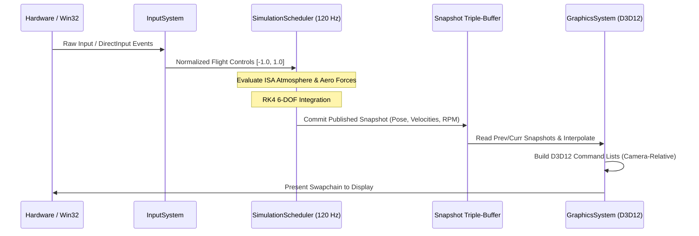

# Engine Architecture Specification: LokYS Flight Simulator

**Revision:** 1.0  
**Status:** Approved Architectural Baseline  

---

## 1. System Decomposition & Subsystem Matrix

The engine is decomposed into 21 discrete, modular subsystems organized across four functional layers:

```mermaid
graph TD
    subgraph Layer3 [Layer 3: Presentation]
        GraphicsSystem["GraphicsSystem (Direct3D 12)"]
        AudioSystem["AudioSystem (XAudio2)"]
    end

    subgraph Layer2 [Layer 2: Systems, Avionics & I/O]
        InputSystem["InputSystem (RawInput / DirectInput)"]
        AvionicsSystem["AvionicsSystem (Six-Pack Gauges)"]
        NavigationSystem["NavigationSystem (VOR / DME / ILS)"]
        SerialInterfaceSystem["SerialInterfaceSystem (COM Telemetry)"]
        ScenarioSystem["ScenarioSystem"]
        TelemetrySystem["TelemetrySystem"]
    end

    subgraph Layer1 [Layer 1: Aerospace Simulation Core]
        FlightDynamicsSystem["FlightDynamicsSystem (6-DOF)"]
        AerodynamicsSystem["AerodynamicsSystem (Polars / NACA)"]
        PropulsionSystem["PropulsionSystem (Piston / Prop)"]
        GroundDynamicsSystem["GroundDynamicsSystem (Struts / Tires)"]
        CollisionSystem["CollisionSystem"]
        WeatherSystem["WeatherSystem (ISA Atmosphere)"]
    end

    subgraph Layer0 [Layer 0: Platform & Infrastructure]
        SimulatorCore["SimulatorCore (Lifecycle & State Machine)"]
        PlatformSystem["PlatformSystem (Win32 Window & Events)"]
        TaskScheduler["TaskScheduler (Worker Pool)"]
        FileSystem["FileSystem (Async I/O)"]
        AssetSystem["AssetSystem (glTF 2.0 & Cache)"]
        ConfigurationSystem["ConfigurationSystem"]
        DiagnosticsSystem["DiagnosticsSystem (PIX / Profiling)"]
    end

    Layer0 --> Layer1
    Layer1 --> Layer2
    Layer2 --> Layer3
```

---

## 2. Threading & Execution Model

The simulation operates on a decoupled multi-timeline model to guarantee physical determinism while maintaining smooth visual frametimes:

1. **Platform Event Thread (Main Thread):**
   - Win32 message pump (`GetMessage` / `PeekMessage`).
   - High-DPI, window resize, focus management.
   - Raw Input / DirectInput message processing.

2. **Simulation Scheduler (Fixed Timestep Thread - 120 Hz):**
   - Fixed time step $\Delta t_{sim} = 1/120 \approx 8.333 \text{ ms}$.
   - Executes weather sampling, aerodynamics force evaluation, engine thrust, ground reactions, and RK4 numerical integration.
   - Publishes immutable flight state snapshots into a lockless triple-buffer.
   - Clamped delta accumulator prevents the "spiral of death" during CPU spikes.

3. **Graphics Submission (Render Thread - Variable Refresh Rate):**
   - Polls latest simulation snapshots from the triple buffer.
   - Performs state interpolation: $S_{render} = \text{lerp}(S_{prev}, S_{curr}, \alpha)$ where $\alpha = \text{accumulator} / \Delta t_{sim}$.
   - Records Direct3D 12 command lists (camera, terrain, aircraft geometry, UI).
   - Submits command lists to DX12 Direct Queue and signals presentation fence.

4. **Task Pool Workers (Job System):**
   - Background asset streaming, terrain tile mesh generation, and audio processing jobs.

---

## 3. Data Flow & State Synchronization

---

## 4. Headless Execution Contract

The engine architecture guarantees that:
* `FlightDynamicsSystem`, `AerodynamicsSystem`, `PropulsionSystem`, and `AvionicsSystem` have **zero** linkage or runtime dependencies on `GraphicsSystem` or `AudioSystem`.
* Continuous integration and automated regression suites can execute complete flight scenarios in headless console mode at $>1000\times$ real-time speed.
